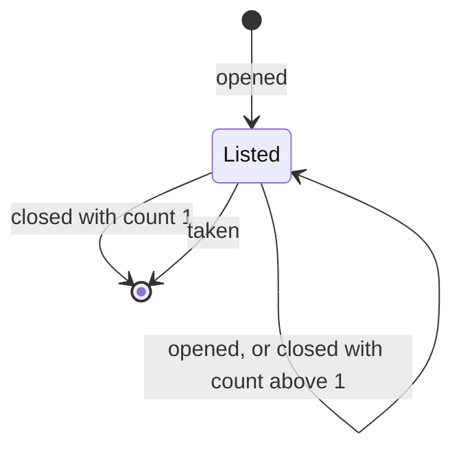

# Spec: a lobby

Two people start a game without sharing a code. The host names themselves and creates a game. The
game then shows in a list that every visitor to the start screen sees. A second person names
themselves and picks the game from the list.

This document states what gets built and why. The rules of the game are in [the game flow
document](GAME-FLOW.md). What the server does today is in [the design document](DESIGN.md). The
browser this extends is in [the web UI spec](SPEC-WEB-UI.md).

## What changes for a player

| Before | After |
| --- | --- |
| The host creates a game and sends its id to the other player. | The host types a name and creates a game. The game shows in the lobby. |
| The other player types the id into the start screen. | The other player types a name and clicks the game in the lobby. |
| The table says "you" and "opponent". | The table shows both names. |

Join by id stays. A link to a game still works, and it is how a player invites one person in
particular.

Every waiting game is listed. There is no private game.

## Names

A `PlayerName` is the label a player gives themselves. It is not an identity. Two players can
have the same name, and the token stays the only claim to a seat.

`PlayerName` has a private constructor. `PlayerName.from(raw: String): Option[PlayerName]` trims
the input and accepts 1 to 20 characters with no control characters. Nothing after it checks a
name again.

| Type | Change |
| --- | --- |
| `Names` | New. `Names(one, two)` with `apply(player)`, which mirrors `Tokens`. |
| `Game.AwaitingOpponent` | Gains `hostName: PlayerName`. |
| `Game.InPlay`, `Game.Over` | Gain `names: Names`. |
| `Game.joined` | Takes the guest's name and builds `Names(hostName, guestName)`. |
| `PlayerView.AwaitingOpponent` | Gains the requester's own name. |
| `PlayerView.InPlay`, `PlayerView.Over` | Gain `names: Names`. |
| `GameService.create`, `GameService.join` | Take a `PlayerName`. |

A name is public, so the new view fields add nothing to redaction.

## The lobby

A `Listing(id: GameId, host: PlayerName, since: ListedAt)` is one row. `since` is the time that
the host's stream opened. `ListedAt` wraps epoch milliseconds, because `core` is cross-built and
`java.time.Instant` on Scala.js needs a library the build does not have.

`Lobby` is a pure value in `core/domain`. It maps a `GameId` to a listing and a watcher count. Its
constructor is private, and a count is always 1 or more.

The table is the authority on the transitions. The diagram is an overview of one row.

| Transition | Row absent | Row present with count n |
| --- | --- | --- |
| `opened(id, host, at)` | Add the row with count 1. | Count becomes n + 1. `since` is unchanged. |
| `closed(id)` | No change. | Count becomes n - 1. The row goes at 0. |
| `taken(id)` | No change. | The row goes. |

`listings` returns the rows oldest first.



A count rather than a flag keeps the row while the host is still there. With a flag, a host with
two tabs loses the row when one tab closes. A refresh whose new stream opens before the old one
closes also loses it.

`LobbyBoard[F]` is the driven port that holds the lobby.

```scala
trait LobbyBoard[F[_]] {

  def change(f: Lobby => Lobby): F[Unit]

  def watch: Stream[F, List[Listing]]
}
```

`change` is atomic, for the same reason that `GameRepository.update` takes a change. `watch`
starts with the listings as they are and then emits each change, so there is no gap between asking
and listening. The memory adapter is a `SignallingRef[F, Lobby]`, read through
`discrete.map(_.listings).changes`. It lasts as long as the process, like the repository.

## Presence

A game is listed while its host holds a stream open on it and the game is still waiting. Only
`Games.watch` writes to the board. `create` and `join` do not touch it.

When `watch` seats the caller as `Player.One` on a game that reads as `AwaitingOpponent`, it wraps
the event stream in a bracket:

1. On open, read the clock and apply `opened(id, hostName, at)`.
2. For each game the stream emits that is not `AwaitingOpponent`, apply `taken(id)`.
3. On close, failure or cancellation, apply `closed(id)`.

Step 2 closes both races with a join. Suppose that a join lands between the read and step 1.
The stream then starts with the game as `InPlay`, so the row goes at once. If a join lands
later, the host is watching and sees it. A late `closed` after a `taken` is a no-op.

A guest's stream, and a host's stream on a game already in play, are unchanged.

`Games` gains the `LobbyBoard[F]` and a `Clock[F]` constraint beside `Monad`. `Clock` is a
typeclass from cats-effect kernel, which `core` already depends on. It adds no concrete effect.

`LobbyService[F]` is a second driving port, with `listings: Stream[F, List[Listing]]`. `Lobbies`
implements it over the board. It is separate from `GameService`. Every `GameService` call is about
one game and takes a token. The lobby is about all games and takes none.

A player who clicks a row that was taken a moment earlier gets `AlreadyFull` from `join`, as
today.

## HTTP

| Route | Change |
| --- | --- |
| `POST /games` | Takes `{"name":"…"}`. |
| `POST /games/{id}/join` | Takes `{"name":"…"}`. |
| `GET /lobby/events` | New. A server-sent event stream of the listings. No token. |

The adapter decodes the body and calls `PlayerName.from`. If the body is missing or malformed, or
the name breaks the rule, the answer is `400` with `{"error":"malformed-name"}`. The service is not
called. This is a breaking change for a client that creates a game with no body.

Each lobby event is the whole list, for the same reason that each game event is a whole game. A
client that falls behind gets the current list and not a backlog. The lobby stream has the same
heartbeat as the game stream, so the stream code that both routes need moves into one helper.

In `protocol`, `PlayerName` encodes as a bare string, because it is a single-field wrapper.
`Names` and `Listing` derive. A row is `{"id":"…","host":"…","since":1760000000000}`.

## The browser

| Screen | Change |
| --- | --- |
| Start | A name box, the live lobby with a Join button per row, and the create button. The join-by-id box stays. |
| Waiting | Shows the player's own name, and says that the game is in the lobby. The link to send stays. |
| Table | Shows both names where it showed "you" and "opponent". |
| Over | The results use the names. |

The name is kept in `localStorage`, so a returning player does not type it again. The lobby
subscription is active only while the start screen shows. A row reads "Ada, waiting 3 min". The
browser computes the age from `since` with a 30-second tick.

## Testing

The tests are property-based by default.

| Suite | What it states |
| --- | --- |
| `PlayerNameSuite` | `from` accepts exactly the trimmed strings of 1 to 20 characters with no control characters. |
| `LobbySuite` | The lobby matches a reference count per game. An open adds one. A close takes one away, but never below zero. A take sets it to zero. A game is listed while its count is above zero. `listings` is oldest first. `closed` and `taken` on an unknown id change nothing. |
| `GameSuite` and the round suites | `joined` builds `Names(host, guest)`. Settling a round keeps the names. |
| `PlayerViewSuite` | Every view carries the game's names unchanged. |
| A presence suite in `server` | Against the memory adapters, with `TestControl` for the clock. A host stream lists the game. Cancelling it removes the row. Two host streams keep the row until both close. A join removes the row. A join between the read and the open also removes it. A guest stream lists nothing. |
| The route suites | The `400` for a missing or invalid name. The lobby stream's first event and its heartbeat. |
| The `ui` suites | The pure `update` for the name box, the lobby events, and a refused join. |

One property spans the two stores: every listed id is a game that the repository holds as
`AwaitingOpponent`. It lives in the presence suite.

The presence suite is in `server` because it needs a live event stream. The fake in `core`
replays a finite history, so a host's stream there closes as soon as it opens.

## Decisions

| Question | Decision | Why |
| --- | --- | --- |
| Kind of lobby | A list of open games | The player chooses whom to play. |
| Visibility | Every waiting game is listed | One kind of game. Join by id stays for links. |
| Row content | The host's name and the waiting time | Players can tell one game from another. |
| Names | Both players give one, and both show at the table | The table is more useful with names. |
| Freshness | A server-sent event stream | It reuses the game stream's pattern and heartbeat. |
| Abandoned games | Listed only while the host watches | No timers, and `Game` does not change for it. |
| Where the lobby lives | A separate `LobbyBoard`, written only by `Games.watch` | One rule maintains the lobby, and it is tested in pure code. |

## Deliberately left out

- No accounts and no persistent identity. A name lasts for one game.
- No quick match. A player picks a row.
- No private games.
- No deletion of games that nobody watches. They leave the lobby but stay in memory, like every
  other game today.
- No `GET /lobby` snapshot. The stream starts with the current list.
- No chat or other presence in the lobby.
