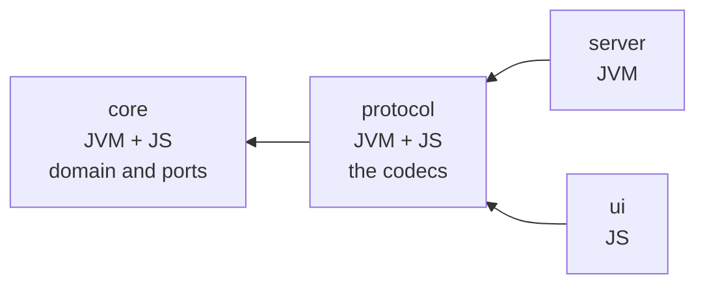

# Spec: a web user interface

Two people play a whole match of gin rummy in a browser, against the server that already exists.

This document states what gets built and why. [The plan](PLAN-WEB-UI.md) states the files, the
tests and the order of the work. The rules of the game are in [the game flow
document](GAME-FLOW.md). What the server does today is in [the design document](DESIGN.md), and
this spec does not restate either of them.

## What the person sees

Once a player holds a seat, the screens are the cases of `PlayerView` and no others. The server
decides what a player is allowed to see. A client that invents a state of its own is a client that
disagrees with the server. Only the start screen sits outside this, because a player with no seat
has no view to be shown.

| Screen | Driven by | What it shows |
| --- | --- | --- |
| Start | No seat yet | A button to create a game, and a box to join one by id. |
| Waiting | `PlayerView.AwaitingOpponent` | A link to send the other player. |
| Table | `PlayerView.InPlay` | The hand, the pile, the moves available, the totals. |
| Over | `PlayerView.Over` | Who won the match, and the final figures. |

The table is one screen rather than two. A finished round appears on it as a panel rather than as
a screen of its own. The server deals the next round the moment one ends, and the view carries the
round that ended in `previous`. There is therefore no moment at which a table has no round to
show.

The table shows the following, and every item comes from a field the view already carries.

| On the table | From |
| --- | --- |
| Your hand, grouped into melds and deadwood | `arrangement` |
| Your deadwood total | `arrangement.deadwoodValue` |
| The upcard | `upcard` |
| How many cards are in the stock and in the pile | `stockSize`, `discardSize` |
| How many cards the other player holds | `opponentSize` |
| Whose turn it is | `onTurn` and `you` |
| The running score | `totals` |
| What the last round came to | `previous` |

Cards are drawn in CSS as text, with the suit in its own color. No graphics and no animation.

## The shape of the build



Four modules. `core` and `protocol` cross-compile to the JVM and to JavaScript. `server` stays on
the JVM and `ui` is JavaScript only. Every arrow still points inward, and `core` still names no
technology.

Both cross-projects use `CrossType.Pure`. This keeps `modules/core/src/main/scala` exactly where it
is. The alternative layout moves every source file in `core` into a `shared` directory, which is a
large diff that buys nothing.

## The protocol module

A browser is a second adapter speaking the same protocol as the HTTP routes. `CLAUDE.md` keeps
codecs out of `core`, and that rule stands. The codecs move one module out instead of one module
in.

`Codecs.scala` moves from `wiggly.gin.server.adapter.http` to `wiggly.gin.protocol`, and
`CodecsSuite` moves with it. The server imports its codecs rather than owning them. Nothing in the
file changes except the package line.

One derived codec then serves both ends. A field added to `PlayerView` reaches the browser without
anybody editing a decoder. That is the same guarantee the server already has, and it is the reason
the codecs were derived at all.

`core` gains no dependency. `Game` and `GameState` still have no encoder, so the only shape a game
reaches a browser in is a `PlayerView`.

## The moves a player may make

The table has to say which moves are available. That rule exists today in `GameGen.legalMoves`,
which is test-only code. The state machine plan recorded that a client wants it.

A new pure function in `core/domain` answers it from a view:

```scala
object Moves {
  def available(view: PlayerView.InPlay): List[Move]
}
```

A view carries enough to decide. `phase` says whether the player draws or discards. `upcard` says
whether the pile is open. `arrangement` is the player's own cards, so a discard of any card they
hold is expressible. The deadwood left after each discard says which knocks are legal.

Two properties tie it to the rules rather than to a second reading of them. Every move the function
offers for a given round is accepted by the transition function. Every move it leaves out is
refused.

`GameGen.legalMoves` stays where it is. It returns each move paired with the state that move
reaches. That pair is what `walk` and `drain` step the machine with, and a function over a
redacted view cannot return it. A third property pins the two together: for a round in play, the moves the
generator finds for the player on turn are the moves `Moves.available` offers that player.

This is the only addition to `core`. It is a rule of the game, so it belongs there rather than in
the browser. Putting it there stops the client and the server disagreeing about what a player is
allowed to do.

## The user interface

Tyrian is an Elm-style architecture on cats-effect: a model, a message type, a pure `update`, a
pure `view`, and subscriptions.

```scala
enum Model {
  case Start(joining: String, error: Option[String])
  case Connecting(credentials: Credentials)
  case Seated(credentials: Credentials, view: PlayerView, error: Option[String])
}
```

`Connecting` covers the gap between taking a seat and the first view arriving. The server publishes
a game's current state to a new watcher at once, so the gap is short. It exists all the same, and
the model says so rather than holding an empty view.

`Credentials` comes from `core/port` and is already the triple of a game id, a seat and a token.
The model reuses it rather than declaring a second type that means the same thing.

`Seated` holds the `PlayerView` exactly as the server sent it. The client re-models nothing. A
redaction the client re-derives is a redaction with two authors.

Messages split into what the person did and what came back:

```scala
enum Msg {
  case JoiningChanged(id: String)
  case Create
  case Join
  case Play(move: Move)
  case Took(credentials: Credentials)
  case Saw(view: PlayerView)
  case Failed(reason: String)
}
```

Commands go through `tyrian.http.Http` against the API that already exists. The UI reaches the
server through the public routes and nothing else, so a UI that works is evidence that the API
works.

## The event stream

Tyrian ships a subscription for WebSockets and none for server-sent events. The stream the server
already serves therefore needs a small facade over `dom.EventSource`. It is built with `Sub.make`
and its acquire-and-release pair, so a change of game closes the connection.

The alternative is to build the WebSocket adapter that [the design document](DESIGN.md) lists as
later work, and use Tyrian's built-in subscription. That trades about thirty lines of client code
for a whole server-side adapter, so the facade wins. The adapter stays on the later list, behind
the `GameEvents` port.

The stream takes the token as a query parameter, because `EventSource` cannot set a header. The
routes already accept it that way.

## The seat, and the link that shares it

The token goes in `sessionStorage`. A refresh that loses your seat makes the UI unusable, and the
token is the whole of a player's claim to one.

The game id goes in the URL, so the waiting screen offers a link the other player opens. A browser
arriving at a game id with no stored token for it sees the start screen with the id filled in,
ready to join.

There are no accounts and nothing stops a stranger who learns an id from taking the second seat.
That is true of the API today and the UI does not change it.

## How it reaches the image

An sbt resource generator puts the Scala.js linker output into the server's resources. One command
still builds one image, and that image now contains the UI.

The server serves the page from its own classpath with `ResourceService`, which arrives with
`http4s-ember-server` and so adds no dependency.

The order the routes compose in carries two rules, so `GinApi` states it rather than leaving it to
whichever route happens to match first:

```scala
val routes = Router(
  ApiPrefix -> gameRoutes,
  "/"       -> (HealthRoutes[F] <+> WebRoutes[F])
)
```

`/api/v1` and `/health` both answer before the UI does, so the fallback cannot swallow either.
Inside `WebRoutes`, a request that names a file gets that file. Every other path gets
`index.html`, so a link to a game id opens the application.

The handler that turns a route miss into a JSON 404 still wraps the whole router. The static
routes sit inside that wrapper rather than after it, because a route added after it never runs.

Serving the page from the same origin as the API is what means no CORS is needed. The design
document lists CORS among the things deliberately absent, and this keeps that true.

## Versions

Every one of these was resolved against Maven Central rather than remembered.

| Dependency | Version | Note |
| --- | --- | --- |
| Tyrian | 0.14.0 | The last stable release, built with Scala 3.6.4 and so usable from 3.9.0. |
| scalajs-dom | 2.8.0 | For `EventSource` and the DOM types Tyrian exposes. |
| sbt-scalajs | 1.22.0 | Scala 3.9.0 publishes `scala3-library_sjs1_3`, so the project's own Scala version targets JavaScript. |
| sbt-scalajs-crossproject | 1.4.0 | For `CrossType.Pure`. |
| weaver-cats, weaver-scalacheck | 0.13.0 | Both publish for Scala.js at the version already in the build. |

Tyrian 0.30.0-M6 is the current line and is a milestone. This takes the stable release. The
Elm-style API is the part this UI uses, and it is the same in both. A later move is therefore a
version bump rather than a rewrite.

## Testing

The test conventions do not change. Weaver publishes for Scala.js at the version already in use, so
the suites are the same shape as every other suite in the repository.

`update` is pure, so properties cover it directly. A view message replaces the view and keeps the
seat. A failure message keeps the seat and shows a reason. A move message produces the request that
move describes. `view` returns a pure value, so a test reads its structure with no browser and no
DOM automation.

`Moves.available` is tested against the transition function, as the section above describes. That
is the one piece of new domain logic and it gets the heaviest testing.

Node runs the Scala.js suites. It is already on the CI runner.

For coverage, `ui`'s entry point and its `view` are excluded the way `Main` and `HttpServer`
already are. The model, `update` and `Moves.available` count toward the floor.

## Decisions settled up front

| Decision | Choice | Why |
| --- | --- | --- |
| The stack | Scala.js with Tyrian | One language, and the domain types reach the browser, so the wire format cannot drift. The Elm architecture keeps `update` pure, which is what makes the UI testable the way the rest of the code is. |
| Where the codecs live | A new cross-built `protocol` module | `core` stays free of JSON, as `CLAUDE.md` says, and one derived codec serves both ends. |
| The cross-project layout | `CrossType.Pure` | No source file in `core` moves. |
| What the model holds | `PlayerView` unchanged | The server owns the redaction. A client that re-models the view is a second author of it. |
| The screens | The cases of `PlayerView` | The client holds no state the server does not have. |
| Legal moves | A function in `core/domain`, replacing `GameGen.legalMoves` | It is a rule of the game. One statement of it keeps the client and the server in agreement. |
| The event stream | A facade over `dom.EventSource` | Tyrian has no subscription for server-sent events. Thirty lines beats building a WebSocket adapter. |
| The token | `sessionStorage` | A refresh that drops your seat makes the UI unusable. |
| Delivery | A resource generator into `server` | One command, one image, same origin, and therefore no CORS. |
| The Tyrian version | 0.14.0 | The last stable release. The current line is a milestone. |

## Where the code came out different

Everything above is what landed, with these exceptions.

| The spec said | The code does | Why |
| --- | --- | --- |
| The page answers every path beneath `/` that is not a file | The application's paths are under `/play` | A fallback over the whole of `/` also answers the paths this server already promises a JSON 404 for. Two existing tests said so, and they were right. |
| `GameGen.legalMoves` keeps its place, pinned by a property | It does, and `GameGen.inPlay` was added beside it | A generator that filtered a played game for one still in play was at the mercy of how often a walk ends a match. This one is built rather than filtered. |
| The seat is read and written through `sessionStorage` | What a seat reads and writes as is split from the storage it uses | Node has no `window`, so the first version needed a jsdom environment and an npm dependency for two assertions. Splitting them tests the part that can be wrong and leaves two browser calls untested, as `Main` and `HttpServer` already are. |
| Nothing about decoders | `protocol` gained a decoder for every shape the server sends | The spec assumed the codecs were symmetric. They were not: the server only ever wrote these shapes, so only encoders existed. The browser has to read them. |
| `scalaJSUseMainModuleInitializer := true` | It is `false` | Tyrian exports `launch` rather than a `main`, so the page starts the application. |
| The resource generator reads the linker's output directory | It asks for the link first, then reads the directory | Reading the directory is a setting and links nothing. Without the extra line the copy takes whatever a previous build left. After a clean that is nothing, and the image builds with no UI in it. |
| Nothing about coverage on Scala.js | Coverage is off for every Scala.js target | scoverage instruments with JVM-only collections, which do not link under Scala.js. `core` and `protocol` are still measured on their JVM side. |
| `circe-parser` is not mentioned | `ui` depends on it | `protocol` defines codecs and needs no parser. The browser receives payloads as strings, so the artifact that turns a string into Json belongs with the adapter that receives them. |

The bundle is 2.8MB of JavaScript before compression, which is the price of the shared domain
types and of cats-effect in a browser. It was a known cost of this approach rather than a surprise.

## Deliberately left out

- No WebSocket. It stays on the later list, behind `GameEvents`, as the design document has it.
- No lobby, no listing of games and no accounts. The API has none of those and this adds none.
- No offline play and no service worker. A game lives on the server.
- No animation, no card graphics and no drag and drop. Cards are text in CSS.
- No layout work past a single column that reads on a narrow screen. A real responsive pass is a
  separate piece of work with its own design.
- No reconnect handling past what `EventSource` does on its own. A browser retries a dropped
  stream, and a reload recovers the seat from `sessionStorage`.
